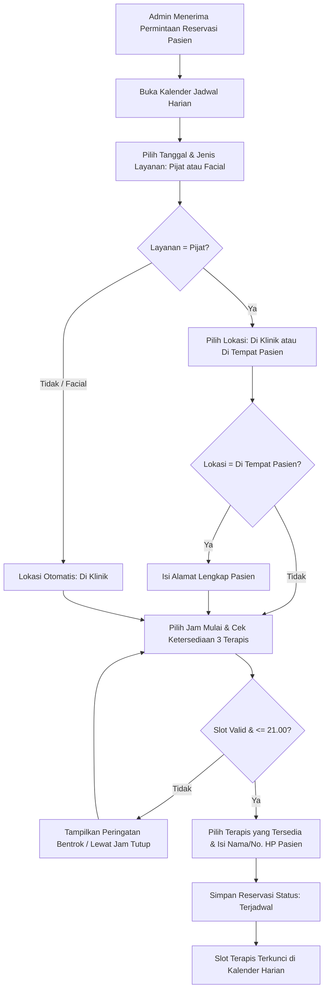

# Product Requirements Document — Aplikasi Penjadwalan Klinik Kesehatan (Pijat & Facial)

**Document Version:** 1.0  
**Application Version:** MVP / v0.1  
**Status:** Draft  
**Last Updated:** November 20, 2026  

---

## 1. Document Information

| Attribute | Details |
| :--- | :--- |
| **Product Name** | Aplikasi Penjadwalan Klinik Kesehatan (Pijat & Facial) |
| **Product Type** | Web Application (Internal Admin Tool) |
| **Product Theme** | Manajemen Reservasi & Penjadwalan Operasional Klinik |
| **Product Purpose** | Membantu admin klinik mengelola reservasi layanan pijat (di klinik & di tempat pasien) dan layanan facial secara akurat tanpa bentrok jadwal terapis. |
| **Primary Platform** | Desktop & Mobile Web Browser (Responsive) |
| **Technical Rules & Constraints** | Membutuhkan koneksi internet, validasi jadwal real-time berdasarkan kapasitas 3 terapis, beroperasi pada rentang waktu 10.00–21.00 setiap hari. |
| **PRD Version** | 1.0 |
| **Application Version** | v0.1 (MVP) |
| **Document Status** | Draft |

---

## 2. Problem Background

- **Problem:** Pemesanan layanan kesehatan (pijat dan facial) yang melibatkan 3 terapis dengan pilihan lokasi layanan berbeda (klinik vs. tempat pasien) rentan mengalami bentrok jadwal (*double booking*) dan kesalahan perhitungan durasi jika dicatat secara manual.
- **Who Experiences It:** Admin klinik kesehatan dan 3 orang terapis yang bertugas.
- **Existing Processes:** Pencatatan jadwal dilakukan secara manual (buku agenda, papan tulis, atau spreadsheet sederhana) saat pasien menghubungi klinik.
- **Current Difficulties & Inefficiencies:** Admin harus memeriksa ketersediaan 3 terapis satu per satu secara manual, menghitung waktu selesai layanan tanpa jeda, serta membedakan kebutuhan alamat untuk layanan panggilan ke tempat pasien.
- **Consequences:** Jadwal terapis tumpang tindih, pelayanan melewati jam tutup klinik (21.00), dan keluhan pasien akibat ketidakpastian jadwal.
- **Relevance:** Aplikasi ini menyediakan tampilan jadwal terpusat yang otomatis memvalidasi ketersediaan terapis, durasi layanan, lokasi layanan, dan batas jam operasional.

---

## 3. Product Goals and Success Indicators

| Goal ID | Objective | Success Indicator | Target | Measurement Method |
| :--- | :--- | :--- | :--- | :--- |
| **G-01** | Menghilangkan jadwal bentrok (*double booking*) pada 3 terapis | Jumlah insiden tumpang tindih jadwal terapis | 0 insiden per bulan *(proposed target)* | Audit log jadwal harian |
| **G-02** | Mempercepat proses pembuatan reservasi oleh admin | Rata-rata waktu input pemesanan baru oleh admin | < 60 detik per reservasi *(proposed target)* | Pengujian alur admin (*usability test*) |
| **G-03** | Memastikan seluruh layanan selesai sesuai jam operasional klinik | Persentase sesi yang selesai melewati pukul 21.00 | 0% *(proposed target)* | Validasi sistem pada database jadwal |

---

## 4. Target Users

- **Primary User:** Admin Klinik Kesehatan
  - **Goals:** Melihat ketersediaan terapis secara instan, membuat/mengubah/membatalkan reservasi pasien, dan memastikan detail lokasi layanan (klinik atau tempat pasien) tercatat jelas.
  - **Pain Points:** Sulit melacak jadwal 3 terapis secara bersamaan pada jam sibuk dan khawatir salah menghitung jam selesai layanan.
- **Secondary User:** Terapis Klinik (3 Orang)
  - **Goals:** Mengetahui jadwal penugasan harian, jenis perawatan (pijat/facial), dan lokasi layanan (klinik atau rumah pasien).
  - **Pain Points:** Mendapat jadwal mendadak yang bentrok atau kurang informasi alamat saat harus melayani di tempat pasien.
- **Usage Context:** Digunakan oleh admin melalui komputer meja resepsionis atau tablet/ponsel operasional saat menerima pemesanan pasien (via telepon, WhatsApp, atau datang langsung).

---

## 5. Business Logic

| Rule ID | Rule Name | Specification |
| :--- | :--- | :--- |
| **BL-01** | **Hari & Jam Operasional Klinik** | - **Trigger:** Pembuatan atau perubahan jadwal reservasi. - **Inputs:** Tanggal layanan, jam mulai (`T_start`), durasi layanan (`D`). - **Processing:** Klinik beroperasi 7 hari seminggu (Senin–Minggu) pukul 10.00–21.00. Hitung jam selesai: `T_end = T_start + D`. - **Expected Output:** Jadwal diterima jika `T_start >= 10:00` dan `T_end <= 21:00`. - **Constraints:** Tidak ada hari libur otomatis; `T_end` tidak boleh melewati 21.00 *(asumsi: 21.00 adalah jam tutup klinik)*. - **Exception Handling:** Tolak penyimpanan dan tampilkan pesan bahwa waktu layanan melebihi jam operasional klinik (10.00–21.00). |
| **BL-02** | **Kapasitas Terapis & Anti-Bentrok** | - **Trigger:** Pemilihan terapis atau pengecekan slot waktu pada tanggal tertentu. - **Inputs:** Tanggal, `T_start`, `T_end`, ID Terapis (dari total 3 terapis aktif). - **Processing:** Periksa semua reservasi aktif (`Terjadwal`) pada terapis tersebut di tanggal yang sama. Terjadi bentrok jika: `(T_start_baru < T_end_lama) AND (T_end_baru > T_start_lama)`. - **Expected Output:** Terapis ditandai `Tersedia` jika tidak ada irisan waktu, atau `Tidak Tersedia` jika ada irisan. - **Constraints:** Maksimal 3 reservasi aktif secara bersamaan di seluruh klinik (1 per terapis). - **Exception Handling:** Blokir penyimpanan jika terapis sudah terisi pada rentang waktu tersebut dan sarankan terapis lain yang kosong. |
| **BL-03** | **Aturan Tanpa Jeda Waktu (*Zero Buffer Time*)** | - **Trigger:** Pembuatan reservasi berurutan untuk terapis yang sama. - **Inputs:** `T_end_lama` dan `T_start_baru`. - **Processing:** Jeda antar-sesi ditetapkan sebesar 0 menit. Sesi baru diperbolehkan dimulai tepat pada menit sesi sebelumnya berakhir (`T_start_baru = T_end_lama`). - **Expected Output:** *Contoh:* Sesi 1 pukul 10.00–11.00 selesai; Sesi 2 pada terapis yang sama valid dimulai pukul 11.00–12.00. - **Constraints:** Tidak ada penambahan menit otomatis untuk jeda istirahat/persiapan pada perhitungan slot. - **Exception Handling:** Jika `T_start_baru < T_end_lama`, sistem menolak jadwal karena tumpang tindih (merujuk ke BL-02). |
| **BL-04** | **Jenis Layanan & Aturan Lokasi** | - **Trigger:** Pemilihan kategori layanan pada formulir reservasi. - **Inputs:** Kategori layanan (`Pijat` atau `Facial`), opsi lokasi (`Di Klinik` atau `Di Tempat Pasien`), alamat pasien. - **Processing:** 1. Jika layanan = `Pijat`, admin wajib memilih lokasi (`Di Klinik` atau `Di Tempat Pasien`). Jika memilih `Di Tempat Pasien`, kolom alamat & catatan lokasi menjadi wajib diisi. 2. Jika layanan = `Facial`, lokasi otomatis dikunci ke `Di Klinik`. - **Expected Output:** Data reservasi menyimpan jenis layanan, durasi, lokasi, dan alamat (jika *home service*). - **Constraints:** Layanan `Facial` tidak mendukung opsi `Di Tempat Pasien`. - **Exception Handling:** Tampilkan pesan validasi jika admin memilih `Pijat - Di Tempat Pasien` tetapi kolom alamat kosong. |
| **BL-05** | **Siklus Status Reservasi** | - **Trigger:** Perubahan status pesanan oleh admin. - **Inputs:** Status saat ini dan aksi admin. - **Processing:** Status yang tersedia: `Terjadwal` (mengunci slot terapis), `Selesai` (layanan terlaksana, tetap tercatat di riwayat), dan `Dibatalkan` (melepaskan slot terapis agar bisa dipesan pasien lain). - **Expected Output:** Status diperbarui dan ketersediaan slot terapis langsung menyesuaikan. - **Constraints:** Hanya status `Terjadwal` yang menahan kapasitas terapis. - **Exception Handling:** Konfirmasi diperlukan sebelum mengubah status menjadi `Dibatalkan`. |

---

## 6. Feature Requirements

| Feature Code | Feature Name | Requirement Description | Related Business Logic | Priority | Target Version |
| :--- | :--- | :--- | :--- | :--- | :--- |
| **FT-01** | **Tampilan Kalender & Slot Harian 3 Terapis** | Admin dapat melihat jadwal harian (Senin–Minggu, 10.00–21.00) yang menampilkan ketersediaan masing-masing dari 3 terapis secara berdampingan. | BL-01, BL-02, BL-03 | Must Have | v0.1 (MVP) |
| **FT-02** | **Manajemen Katalog Layanan** | Admin dapat mengelola daftar paket layanan di bawah kategori **Pijat** dan **Facial**, termasuk nama paket, durasi (menit), dan harga. | BL-01, BL-04 | Must Have | v0.1 (MVP) |
| **FT-03** | **Formulir Pembuatan Reservasi** | Admin dapat membuat pesanan baru dengan mengisi data pasien (nama, nomor telepon), memilih jenis layanan (Pijat/Facial), lokasi (Klinik/Tempat Pasien + alamat jika Pijat luar klinik), tanggal, jam mulai, dan memilih terapis yang tersedia. | BL-01, BL-02, BL-03, BL-04 | Must Have | v0.1 (MVP) |
| **FT-04** | **Validasi Slot Otomatis** | Sistem secara otomatis mencegah pemilihan jam yang melewati 21.00 dan menyaring/menandai terapis yang sudah memiliki jadwal bentrok pada rentang waktu yang dipilih. | BL-01, BL-02, BL-03 | Must Have | v0.1 (MVP) |
| **FT-05** | **Pengelolaan Status & Pembatalan Jadwal** | Admin dapat mengubah status reservasi (`Terjadwal`, `Selesai`, `Dibatalkan`) atau menjadwalkan ulang (*reschedule*) pesanan yang ada. | BL-02, BL-05 | Must Have | v0.1 (MVP) |
| **FT-06** | **Manajemen Data Terapis (3 Staf)** | Admin dapat melihat dan mengatur profil dasar 3 terapis klinik (nama terapis dan status aktif). | BL-02 | Should Have | v0.1 (MVP) |

---

## 7. Main User Flow

1. Admin membuka halaman utama penjadwalan dan memilih tanggal yang diinginkan pasien.
2. Admin menekan tombol **"Buat Reservasi Baru"**.
3. Admin memilih jenis layanan dari katalog (kategori **Pijat** atau **Facial**), yang otomatis menentukan durasi layanan.
4. Jika layanan adalah **Pijat**, admin memilih lokasi layanan (**Di Klinik** atau **Di Tempat Pasien**). Jika **Di Tempat Pasien**, admin wajib mengisi alamat pasien. Jika **Facial**, lokasi otomatis ditetapkan **Di Klinik**.
5. Admin memilih jam mulai layanan (antara pukul 10.00 hingga batas maksimal sebelum 21.00).
6. Sistem memeriksa ketersediaan 3 terapis berdasarkan durasi layanan dan aturan tanpa jeda (0 menit).
7. Admin memilih salah satu terapis yang berstatus **Tersedia**, lalu melengkapi nama dan nomor kontak pasien.
8. Admin menekan **"Simpan Reservasi"**. Sistem menyimpan jadwal dengan status `Terjadwal` dan langsung menampilkan blok jadwal pada kalender harian.

---

## 8. Acceptance Criteria

| AC ID | Related Feature | Condition | Expected Behavior | Pass Criteria |
| :--- | :--- | :--- | :--- | :--- |
| **AC-01** | FT-01, FT-04 | Given jadwal klinik dibuka pada hari apa pun (Senin–Minggu), When admin melihat rentang waktu operasional, Then sistem menampilkan jam layanan 10.00–21.00 untuk 3 terapis. | Kalender menampilkan 7 hari seminggu dan slot waktu 10.00–21.00 secara akurat. | Tidak ada hari yang terkunci secara default dan batas jam sesuai. |
| **AC-02** | FT-03, FT-04 | Given layanan berdurasi 90 menit dipilih, When admin memilih jam mulai pukul 20.00, Then sistem menolak jadwal karena jam selesai (21.30) melewati batas 21.00. | Tombol simpan dinonaktifkan atau muncul pesan error batas jam operasional. | Reservasi tidak tersimpan jika `T_end > 21:00`. |
| **AC-03** | FT-03, FT-04 | Given Terapis A sudah memiliki jadwal pukul 10.00–11.00, When admin membuat jadwal baru untuk Terapis A pukul 11.00–12.00, Then sistem mengizinkan penyimpanan tanpa jeda waktu. | Jadwal tersimpan dan tampil bersebelahan tepat pukul 11.00. | Reservasi berhasil disimpan dengan selisih waktu 0 menit. |
| **AC-04** | FT-03, FT-04 | Given Terapis A sudah memiliki jadwal pukul 10.00–11.00, When admin mencoba menjadwalkan Terapis A pukul 10.30–11.30, Then sistem mencegah pemilihan Terapis A. | Terapis A ditandai tidak tersedia; sistem menolak jika dipaksakan. | Tidak ada *double booking* pada terapis yang sama. |
| **AC-05** | FT-03 | Given admin memilih layanan **Pijat** dan lokasi **Di Tempat Pasien**, When kolom alamat dikosongkan dan tombol simpan ditekan, Then sistem menampilkan peringatan kolom wajib diisi. | Form gagal disimpan dan menyorot kolom alamat. | Alamat selalu terisi untuk layanan pijat di tempat pasien. |
| **AC-06** | FT-05 | Given reservasi berstatus `Terjadwal` pada Terapis B pukul 14.00–15.00, When admin mengubah status menjadi `Dibatalkan`, Then slot Terapis B pada pukul 14.00–15.00 kembali tersedia. | Terapis B muncul sebagai `Tersedia` saat pencarian slot 14.00–15.00. | Slot langsung bebas setelah pembatalan. |

---

## 9. Validation Test Scenarios

| Test ID | Related Requirement | Scenario | Test Input | Expected Result | Test Type |
| :--- | :--- | :--- | :--- | :--- | :--- |
| **TC-01** | BL-01, AC-02 | Pemesanan melewati jam tutup (21.00) | Layanan: Pijat 60 menit; Jam Mulai: `20:30` | Ditolak dengan pesan error karena selesai pukul `21:30` (> `21:00`). | Boundary |
| **TC-02** | BL-01 | Pemesanan tepat berakhir pukul 21.00 | Layanan: Pijat 60 menit; Jam Mulai: `20:00` | Diterima dan tersimpan dengan jam selesai tepat `21:00`. | Boundary |
| **TC-03** | BL-03, AC-03 | Pemesanan berurutan tanpa jeda (0 menit) | Terapis 1 terisi `13:00–14:30`; Input baru Terapis 1 pada `14:30–15:30` | Diterima dan tersimpan tanpa peringatan bentrok. | Normal / Boundary |
| **TC-04** | BL-02, AC-04 | Bentrok jadwal pada terapis yang sama | Terapis 1 terisi `13:00–14:30`; Input baru Terapis 1 pada `14:00–15:00` | Ditolak; sistem menginformasikan Terapis 1 bentrok. | Invalid Input |
| **TC-05** | BL-02 | Kapasitas penuh 3 terapis bersamaan | Terapis 1, 2, dan 3 semua terisi pada `15:00–16:00`; Input pasien ke-4 pada `15:00–16:00` | Tidak ada terapis yang tersedia; sistem menolak pemesanan ke-4 di jam tersebut. | Boundary |
| **TC-06** | BL-04, AC-05 | Pijat di tempat pasien tanpa alamat | Layanan: `Pijat`; Lokasi: `Di Tempat Pasien`; Alamat: `""` (kosong) | Validasi gagal; muncul pesan bahwa alamat pasien wajib diisi. | Invalid Input |
| **TC-07** | BL-04 | Pemilihan layanan Facial | Layanan: `Facial` | Opsi lokasi `Di Tempat Pasien` tidak tersedia / otomatis terkunci ke `Di Klinik`. | Conditional Flow |
| **TC-08** | BL-05, AC-06 | Pembatalan jadwal membebaskan slot | Ubah status reservasi Terapis 2 (`16:00–17:00`) menjadi `Dibatalkan` | Slot `16:00–17:00` untuk Terapis 2 kembali berstatus `Tersedia`. | State Transition |

---

## 10. Constraints and Out of Scope

### Business Constraints
- Jumlah total terapis aktif dibatasi maksimal **3 orang**.
- Klinik beroperasi setiap hari (7 hari/minggu) mulai pukul **10.00 hingga 21.00**.
- Tidak ada waktu jeda otomatis antar-sesi layanan (jeda = 0 menit).
- Pilihan lokasi layanan di tempat pasien (*home service*) hanya berlaku untuk kategori **Pijat**.

### Technical Constraints
- Sistem dirancang sebagai aplikasi web responsif yang diakses melalui browser oleh admin klinik.
- Penyimpanan data menggunakan database terpusat agar status jadwal tetap konsisten meskipun diakses dari perangkat admin yang berbeda.
- Memerlukan otentikasi login sederhana bagi admin agar data pasien dan jadwal terlindungi.

### Out of Scope (Di Luar Cakupan MVP v0.1)
- **Portal Pemesanan Mandiri Pasien (*Self-Booking*):** Pasien tidak melakukan pemesanan langsung di aplikasi; seluruh input dilakukan oleh admin.
- **Integrasi Pembayaran Online (*Payment Gateway*):** Pencatatan transaksi keuangan atau pembayaran digital tidak termasuk dalam MVP penjadwalan ini.
- **Perhitungan Otomatis Waktu Perjalanan (*Travel Time*):** Karena aturan operasional menetapkan tidak ada jeda waktu antar-sesi, estimasi jarak tempuh perjalanan terapis ke rumah pasien tidak dihitung otomatis oleh sistem.
- **Notifikasi WhatsApp API Otomatis:** Pengiriman pengingat otomatis via API pihak ketiga ditunda ke tahap pengembangan berikutnya.

---

## 11. Data and Configuration Requirements

### Data Konfigurasi (Master Data)
1. **Terapis (`Therapist`)**
   - `therapist_id` (String/UUID, Primary Key)
   - `name` (String, Wajib — maks. 3 entitas aktif untuk kapasitas klinik saat ini)
   - `is_active` (Boolean, Default: `true`)
2. **Layanan (`Service`)**
   - `service_id` (String/UUID, Primary Key)
   - `category` (Enum: `PIJAT`, `FACIAL`)
   - `service_name` (String, Wajib — contoh: "Pijat Refleksi 60 Menit", "Basic Facial")
   - `duration_minutes` (Integer, Wajib — contoh: `60`, `90`, `120`)
   - `price` (Decimal/Integer, Opsional pada tampilan jadwal)
   - `allow_home_service` (Boolean — `true` untuk `PIJAT`, `false` untuk `FACIAL`)

### Data Transaksional (User-Generated Data)
3. **Reservasi (`Booking`)**
   - `booking_id` (String/UUID, Primary Key)
   - `patient_name` (String, Wajib)
   - `patient_phone` (String, Wajib)
   - `service_id` (Foreign Key -> `Service`)
   - `therapist_id` (Foreign Key -> `Therapist`)
   - `booking_date` (Date, Wajib)
   - `start_time` (Time, Wajib — format `HH:MM`, `>= 10:00`)
   - `end_time` (Time, Dihitung otomatis: `start_time + duration_minutes`, `<= 21:00`)
   - `location_type` (Enum: `CLINIC`, `HOME_SERVICE`)
   - `patient_address` (Text, Wajib jika `location_type == HOME_SERVICE`)
   - `notes` (Text, Opsional)
   - `status` (Enum: `SCHEDULED`, `COMPLETED`, `CANCELLED`)
   - `created_at` & `updated_at` (Timestamp)

---

## 12. Development Roadmap

- **Phase 1 — MVP (v0.1): Core Admin Scheduling**
  - Setup master data 3 terapis dan katalog layanan (Pijat & Facial).
  - Tampilan kalender jadwal harian (10.00–21.00, 7 hari seminggu).
  - Formulir pembuatan reservasi dengan validasi anti-bentrok, aturan tanpa jeda (0 menit), serta pilihan lokasi (Klinik / Tempat Pasien).
  - Perubahan status jadwal (`Terjadwal`, `Selesai`, `Dibatalkan`).
  - *Acceptance Gate:* Lulus seluruh skenario uji `TC-01` hingga `TC-08`.
- **Phase 2 — Operational Enhancement (v0.2)**
  - Template salin pesan konfirmasi jadwal ke WhatsApp pasien.
  - Pencarian riwayat reservasi berdasarkan nama atau nomor telepon pasien.
  - Laporan ringkas jumlah sesi harian/bulanan per terapis.

---

## 13. Assumptions, Open Questions, and Risks

- **Confirmed Decisions:**
  - Layanan meliputi Pijat dan Facial.
  - Operasional 7 hari seminggu, pukul 10.00–21.00.
  - Pemesanan dilakukan dengan bantuan admin.
  - Total terapis aktif adalah 3 orang.
  - Layanan pijat memiliki pilihan lokasi di klinik atau di tempat pasien.
  - Tidak ada waktu jeda (*buffer time* = 0 menit) antar-sesi.
- **Proposed Assumptions:**
  - Seluruh 3 terapis memiliki kompetensi untuk menangani baik layanan pijat maupun facial (kolam terapis bersama).
  - Pukul 21.00 adalah jam tutup klinik sehingga layanan harus selesai maksimal pukul 21.00.
  - Layanan facial hanya dilakukan di klinik (tidak melayani panggilan ke tempat pasien).
- **Unresolved Noncritical Questions:**
  - Daftar rincian nama paket layanan spesifik dan durasi masing-masing paket (misalnya 60 menit, 90 menit, 120 menit) yang akan dimasukkan admin saat pengaturan awal.
- **Product & Operational Risks:**
  - **Risiko Keterlambatan Terapis *Home Service*:** Karena tidak ada jeda waktu antar-sesi (`BL-03`), jika terapis baru saja menyelesaikan sesi pijat di tempat pasien pukul 13.00 dan langsung dijadwalkan di klinik pukul 13.00, terapis akan terlambat tiba di klinik. *Mitigasi:* Admin disarankan memeriksa lokasi sesi sebelumnya di kalender harian sebelum menugaskan terapis yang sama pada jam berurutan.

---

## 14. Requirement Traceability

| Business Logic | Feature Code | Acceptance Criteria | Test Case |
| :--- | :--- | :--- | :--- |
| **BL-01** (Jam Operasional 10.00–21.00) | FT-01, FT-02, FT-03, FT-04 | AC-01, AC-02 | TC-01, TC-02 |
| **BL-02** (Kapasitas 3 Terapis & Anti-Bentrok) | FT-01, FT-03, FT-04, FT-06 | AC-04 | TC-04, TC-05 |
| **BL-03** (Tanpa Jeda Waktu / 0 Menit) | FT-01, FT-03, FT-04 | AC-03 | TC-03 |
| **BL-04** (Jenis Layanan & Aturan Lokasi) | FT-02, FT-03 | AC-05 | TC-06, TC-07 |
| **BL-05** (Siklus Status Reservasi) | FT-05 | AC-06 | TC-08 |